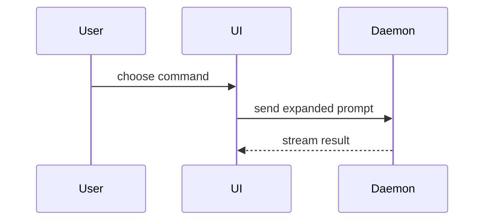

Help the user understand the current topic of conversation visually. Skip the preamble and keep prose brief. Pick the smallest view that makes the key point clear.

- Show logic or an algorithm as pseudocode:

```text
on(save)
  if content is unchanged
    return cached result
  write new content
  return fresh result
```

- Show runtime control flow as a call tree:

```text
submitForm
  createSession
    persistPrompt
    launchAgent
  navigateToSession
```

- Show UI structure as a component tree, including state and module boundaries that matter:

```tsx
<SessionPage> (apps/example/src/routes/session.tsx)
  useSessionEvents()
  <SessionToolbar>
    <RunSkillButton> (packages/ui)
```

- Show file responsibility or a broad refactor as a shallow file tree:

```text
src/
├── commands/       # parses user actions
├── sessions/       # owns session state
└── transport/      # sends API requests
```

- Show component interaction, control flow, or data flow with Mermaid:



- Use `diff` when the point is what changes and the surrounding shape already exists. Match the diff shape to the topic.

For a component change:

```diff
 <SessionPage>
   useSessionEvents()
   <SessionToolbar>
+    <RunSkillButton />
   <SessionTimeline>
+    <SkillResultCard />
```

For a file-layout change:

```diff
 src/
 ├── commands/
+│   └── show-me.ts       # expands the slash command
 ├── sessions/
-└── transport.ts
+└── transport/
+    ├── client.ts
+    └── stream.ts
```

For a call-tree or call-stack change:

```diff
 submitForm
   createSession
     persistPrompt
+    expandSkillMention
     launchAgent
-  navigateToSession
+  navigateToSession
+    subscribeToEvents
```

For a state or control-flow change:

```diff
 on(save)
-  write content
+  if content is unchanged
+    return cached result
+  write new content
+  invalidate cache
```

- Show the whole block when most of it is new, when omitted context would hide ownership or order, or when the user needs a copyable target shape:

```ts
function expandSkill(command: string): string {
  const skillName = command.slice(1)
  return `use the ${skillName} skill`
}
```

- For a visual UI, layout, state comparison, or concept too dense for Mermaid, write one focused HTML file — a diagram, an infographic, or a short slide deck, whichever fits the point. Match the product's colors, type, spacing, and components; use real labels and data; support desktop and mobile. **Never open it yourself** — no `open`, no browser launch. Before writing, follow **one topic, one file** below to decide whether this is a new file or a new iteration of an existing one. Print its absolute path so the user can open it when they choose:

```
$HOME/Documents/knowledge-base-remote/<Project>/docs/plans/<topic-folder>/show-me-<topic>.html   (printed fully expanded)
```

### guidance

Place each visual next to the short text it supports. Keep only the calls, files, props, states, and boundaries needed to answer the user's current question or the options to resolve the current discussion point.

You may use one of these, you may use several, it is unlikely you will use all of them. Use your judgement and don't overwhelm the user.

### rendering — the user must see it rendered, not as source

This user reads output in a terminal, which does **not** render Mermaid and does not reliably
align box-drawing or ASCII tables. Raw Mermaid source or a hand-aligned text table is not a
visual; it is code the user has to render in their head.

- **Any Mermaid diagram, any table, and any side-by-side comparison goes into one HTML file,
  whose absolute path you then print. Never run `open` on it.** Render tables as real `<table>` elements, not preformatted text.
  Mermaid renders in-page from `https://cdn.jsdelivr.net/npm/mermaid@11/dist/mermaid.esm.min.mjs`
  (no local `mmdc` is installed).
- Plain indented text is fine inline only for views that survive a monospace terminal as-is:
  short pseudocode, call trees, file trees, and small `diff` blocks.
- Write the HTML into a topic folder under the project's knowledge-base plans folder (see
  **one topic, one file**), never inside a git working tree and never loose at the plans root.
- **Always give the full absolute path** (the home directory expanded to its real value, then `Documents/knowledge-base-remote/...`) every
  time you mention a page — after creating it, after updating it, and when asking the user which
  page to update. Never a relative or folder-relative path such as `ABC-123/show-me-x.html`, and
  never `~`. The user opens these by pasting the path; anything shorter means hunting for it.
- After writing it, reply with the absolute path on its own line, plus one or two lines saying
  what the page shows — and, when you updated an existing file, which iteration you added and
  what changed. Do not also paste the Mermaid source or the table inline.

### one topic, one file

The user does not want five HTML files about one topic. A repeated "show me" on the same
topic — in this session or a recent one — updates the existing file and adds a tagged
iteration, so the page shows how the plan evolved. Only a genuinely different topic gets a new
file.

**1. Find candidates.** The plans root comes from the "Planning documents" rule in `AGENTS.md`:
`~/Documents/knowledge-base-remote/<Project>/docs/plans/`, where `<Project>` is the project the
current work belongs to (the rule, or the loaded project rules, may name it for the current repo).
List existing pages with their metadata:

```bash
root=~/Documents/knowledge-base-remote/<Project>/docs/plans
find "$root" -name 'show-me-*.html' -print0 | xargs -0 grep -H -o 'name="show-me:\(topic\|summary\|updated\)" content="[^"]*"'
find "$root" -maxdepth 2 -type d    # existing topic folders
```

Any page you already wrote or updated in this session is the strongest candidate.

**2. Let Jev decide; do not decide yourself.** You framed the request, so your own call anchors
on it. Make one `jev` call. Put in `state`: the user's current request in their words, a
one-paragraph summary of what you are about to show, and every candidate page's path, topic,
summary and last-updated date (plus "written earlier in this session" where true), plus the
folder list. Ask, in the same call:

- `target` (choice): one option per candidate page — criteria "same topic or subject as this
  page; the new view continues, revises or redirects it" — plus `new-file` — "a different topic
  from every candidate; a reader would not look for it in any of them".
- `change` (choice): `amend` — fixes typos, labels or a wrong number without changing the plan;
  `revision` — same direction, reworked or extended; `pivot` — the direction, recommendation or
  scope changed.
- `folder` (choice): one option per existing topic folder plus `new-folder`.

Follow the answer unless its confidence is low or Jev is unavailable, in which case ask the user
in one line, naming each candidate by its **full absolute path**. Jev's answer is a routing
decision, not a fact.

**3a. New file.** Put it in the matching topic folder: a ticket folder (`ABC-123/`), a project
or feature folder (`checkout-flow/`), or a subfolder of one (`checkout-flow/new-vs-reopen/`).
If none fits, create a short kebab-case folder named for the topic, not for the date or the
session. Start it at iteration 1.

**3b. Existing file.** Edit that file in place — never write a `-v2` copy beside it.

- `amend`: correct the current iteration in place; no new iteration.
- `revision` or `pivot`: add iteration N+1 at the top as the expanded current view, and collapse
  the previous current iteration into a `<details>` block below. Never delete earlier iterations
  — they are the evolution.

**HTML contract for every page:**

```html
<meta name="show-me:topic" content="Checkout: new vs reopen">
<meta name="show-me:summary" content="One sentence a later session can match against">
<meta name="show-me:updated" content="2026-10-15">
...
<nav class="iterations">  <!-- newest first; each links to its section -->
  <a href="#iter-3">v3 · 2026-10-15 · pivot — split into two PRs</a>
  <a href="#iter-2">v2 · 2026-10-09 · revision — added reopen edge cases</a>
  <a href="#iter-1">v1 · 2026-10-05 · initial</a>
</nav>
<section id="iter-3" data-iteration="3" data-kind="pivot" data-date="2026-10-15">
  <h2>v3 · pivot</h2>
  <p class="changed">Changed from v2: …one or two lines…</p>
  …current view…
</section>
<details><summary>v2 · 2026-10-09 · revision — added reopen edge cases</summary>
  <section id="iter-2" data-iteration="2" data-kind="revision" data-date="2026-10-09">…</section>
</details>
```

Update `show-me:summary` and `show-me:updated` on every write, and badge each iteration with
its kind (`pivot` visually distinct from `revision`).

When adding iteration N+1, demote the previous current iteration by storing its complete
previous HTML document, escaped, inside its collapsed `<details>` (a `<script type="text/html">`
or hidden `<textarea>`), and on the first `toggle` open load it into an auto-height
`<iframe srcdoc>`. This keeps each iteration's CSS, ids and scripts isolated, and Mermaid only
lays out once the block is visible. The existing pages in the plans folders already use this
pattern — copy the loader from the page you are updating rather than writing a new one.

If a script generates the page (for example a `build_*.py` beside the diagrams), change the
script and rerun it rather than hand-editing its output.
